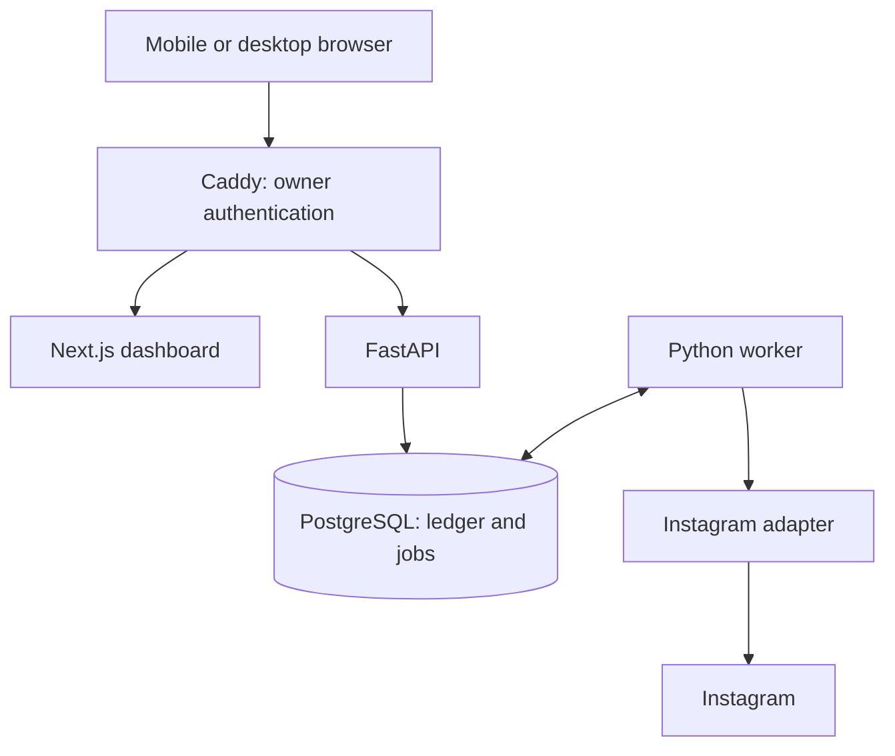

# Architecture and boundaries

## Runtime

The default stack now uses the pinned Instagram image and read-only transport. The UI selects only real accounts; simulation execution is disabled in this mode. Live action capability is not claimed until the owner-operated acceptance checks in IMPLEMENTATION-PLAN.md pass. Browser onboarding is tracked in UI-ONBOARDING-PLAN.md.

## Responsibility split

Next renders controls and displays server state. FastAPI validates ownership, configuration and eligibility, then persists intent. PostgreSQL is the source of truth for history, policy settings, jobs and audits. Worker claims due work, rechecks eligibility, performs the external operation and persists the observation. The adapter translates library-specific responses/errors into domain types. Only the worker eventually receives Instagram session material.

Source discovery and action execution use the same serialized account request lane. Collecting a large follower list must not monopolize it: use page-sized jobs and continuation cursors. Content intake and publishing eventually join this lane with job priorities and explicit request accounting.

## Deployment decisions

PostgreSQL serves as both ledger and queue to remove a separate broker from a one-account server. Use a single worker container initially. The initial simulator uses a short transaction with row locking. Live execution requires a committed claim, account ownership lock, pre-call marker, HTTP call outside the transaction, and reconciliation for uncertain results. Do not place the HTTP request inside the current transaction.

API is synchronous because SQLAlchemy and Instagrapi are synchronous. FastAPI dispatches regular `def` handlers through its thread pool. Instagrapi calls belong in a separate process, so they cannot block API request threads. Start API with one Uvicorn worker; scale only when measurements justify it.

Migrations through0012 add session metadata, append-only attempt events, actual request/action budgets, intent receipts, schedules and encrypted connection handoffs. The API seals passwords/codes using a worker public key; a worker thread consumes them and invokes the serialized account client. Progress is durable, challenge-bound and expiring; the API has no decryptor. Insights/checks, liker watches, scoped relationship tests and immutable content assets/revisioned drafts are durable. Publication approvals reuse the existing job and append-only attempt journal, with frozen render snapshots, fixed upload IDs, dispatch receipts and positive reconciliation. API/worker share authenticated content storage; only the worker has the session key. API and worker share one Python package and the same policy.

## Queue semantics

API acceptance is not Instagram success. `202` returns a durable job. The client polls until a terminal result. Enqueue deduplicates `(account_id, idempotency_key)`; business deduplication also checks permanent history. Live work is not exactly-once: an external side effect can succeed while the local commit fails. The product represents that ambiguity explicitly.

## Security boundary

Only Caddy has a host port. API, DB and web are on the private Compose network. Caddy authenticates the owner, replaces any incoming internal token, strips dashboard Basic credentials upstream and routes `/api/*` to FastAPI. API compares a server-only random token and validates Origin for mutations. The browser uses same-origin requests and never sees the internal token.

Basic Auth is a deliberate single-owner MVP choice. There is no in-app password form or public registration. Browser logout behavior is limited; a polished login/logout flow requires a future session-based auth implementation. HTTPS is required when exposing this on a public hostname. Local setup binds only loopback.

## Figma boundary

Figma Make owns UI generation. It gets a self-contained brief and mock provider. The backend contract remains authoritative. If generated code uses a different router/build system, port reusable components into Next rather than changing the API architecture. Do not put Instagram credentials or private API calls in generated React code.

## Scaling trigger

For several accounts, introduce account-scoped advisory locks and bounded executors after proving recovery. For significant job volume, measure DB contention before adding a broker. For content/video processing, use a separate render process with capped CPU/memory so ffmpeg cannot starve acquisition. This is not needed for the first milestone.
