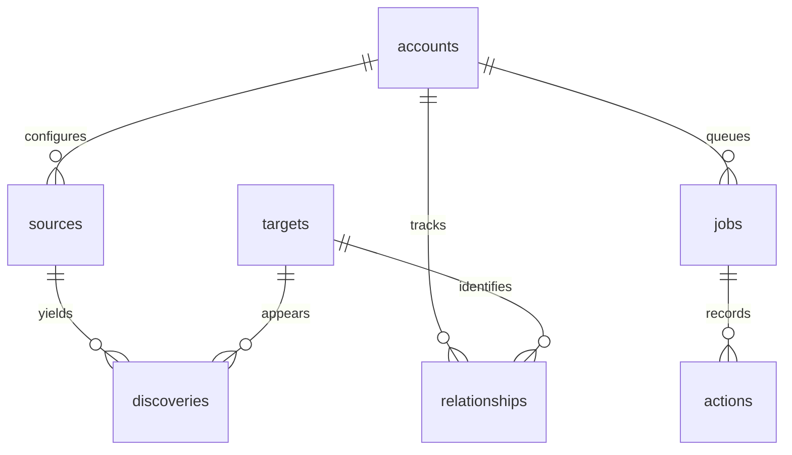

# Database and permanent ledger

## Storage decisions

PostgreSQL 16 named volume. SQLAlchemy models + versioned Alembic migrations. IDs from Instagram are opaque strings (including values larger than JavaScript safe integers). Internal IDs are UUID strings in the initial schema; native UUID can be introduced in a planned migration if desired. All timestamps are timezone-aware UTC. JSON is generic JSON in the scaffold; promote large queryable fields to JSONB when adding relevant indexes.

## Initial tables

| Table | Important columns | Constraints / meaning |
|---|---|---|
| accounts | id, instagram_id, username, paused, mode | Unique Instagram ID when known; starts paused |
| sources | account_id, kind, value, enabled | Unique account/kind/value |
| targets | id, username | Stable Instagram ID key; `demo-*` IDs only in fixtures |
| relationships | account_id, target_id, state, flags, timestamps, version | Unique account/target; lifetime ledger |
| discoveries | source_id, target_id, first/last_seen | Unique source/target; overlaps preserved across sources |
| jobs | account_id, target_id, kind, state, due time, payload, key | Unique account/idempotency key; due index |
| actions | job_id, kind, outcome, simulated, detail | One result per job in simulator; evolve to attempts for live |
| audit_events | account_id, event, detail, time | Owner/configuration events |

## Relationship semantics

`observed_state`: unknown, none, requested, following. `ever_followed`: monotonic true after a real accepted follow OR outgoing request. It never becomes false after unfollow/cancellation. Existing imported follows/requests also count as already touched. `managed`: true only when this system created the connection or the owner explicitly adopted it. `protected`: preserve relationship, skip acquisition/cleanup. `excluded`: exclude from automation. Neither flag deletes history.

`follow_requested_at` records a private request. `follow_confirmed_at` records first confirmed following. `unfollow_due_at` uses configured retention from confirmation. `unfollow_confirmed_at` records observation after successful cleanup. `last_checked_at` is freshness, not the date the Instagram relationship changed. A missing user in a partial follower collection is not proof of unfollow.

Simulation does not set any of these external observations. Simulated progress is shown through jobs and actions. Real and mock archive accounts must be separate to avoid interpreting fictional identities as Instagram IDs.

## Live-phase migrations

1. Add username_history, account_settings (versioned), session metadata, source cursor/order/completeness, follows_back and observed_at.
2. Add job claim owner, lease expiry, heartbeat, dispatch_started_at, priority, attempt count and request fingerprint.
3. Add action_attempts with append-only timestamps, external disposition, redacted error and reconciliation status. One job can have multiple read/reconciliation attempts; don't overwrite evidence.
4. Add budget_usage/reservations with account, local-calendar day, category, reserved/consumed units. Use atomic updates with limits and expired reservation cleanup.
5. Add a unique follow-intent/business marker per account/target so different HTTP keys cannot schedule duplicate acquisition. Preserve it after success. Resolve failed/unknown attempts through explicit state rather than deleting evidence.

Foreign keys use no broad cascading deletions. Disable sources instead of deleting provenance. Index source candidates, relationships(account_id, protected), relationship due times, actions timestamps and job(account_id,state,scheduled_at). Do not add indexes without a query that needs them.

## Reconciliation

Refresh current status before important mutations, particularly after manual app use. Cache freshness and API collection completeness must be explicit. If a follow request succeeded but DB commit failed, reconcile and set ever_followed before releasing the candidate. If the result remains unclear, retain unknown and prevent a repeat follow.

## Migrations and backup

Initial revision is generated as fixed Alembic operations, not dynamically imported model metadata. Run `alembic upgrade head` in a one-shot container before API/worker. Snapshot before destructive migrations and test upgrades against a restored copy. `pg_dump -Fc` is the logical backup format; keep encrypted copies off-server. A named volume survives container replacement but is not a backup. Never run `docker compose down -v` as routine maintenance.

## Phase 2 tables

content_items (source media ID/URL, sender, state, caption, revision); assets (hash, type, path, dimensions, original position); content_assets (position, crop, item revision); messages (account/thread/message composite identity, processing cursor); publications (revision, schedule, remote ID, state); permission_records; music_selection. Keep content publication attempt history separate from follow/unfollow actions.
