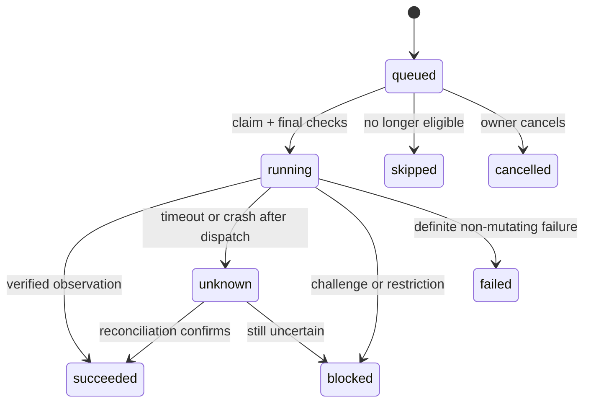

# Worker and scheduler design

## Delivered behavior

One Python process polls jobs every configured few seconds. It claims one due queued job whose account is unpaused using `FOR UPDATE SKIP LOCKED`. It locks the target relationship, rechecks protection/exclusion/history and writes simulated/skipped action + terminal job state in one DB transaction. No external HTTP request occurs, so a crash rolls back cleanly. SIGTERM stops between iterations. Scheduling is based on explicit job timestamps only.

This implementation demonstrates persistence and policy rechecks. It does not implement Instagram calls, automatic due-unfollow generation, per-day quotas, worker heartbeat or ambiguous network recovery. Those must be implemented before live mode is added.

## Required live lifecycle

Simulation ends in `simulated`, a separate terminal state. A running mutation cannot be cancelled as if it never happened.

## Claiming and account serialization

Use a dedicated PostgreSQL advisory lock per Instagram account, held on a dedicated DB connection across the request lane, or a robust equivalent. A job-row lock alone does not prevent two workers acting on two jobs for the same account. Initial production deployment remains one worker. On DB ownership/connection loss, the process must stop dispatching; do not continue using an old lease.

Claim job and commit its owner/lease. Validate account state, operating window, budgets and relationship under a short transaction; write an intent/attempt record with `dispatch_started_at`. Commit, then call Instagram outside the transaction. Bound network timeouts. Persist result in a new transaction. External call success + local DB failure is unknown until reconciled.

Before live release, prevent a replacement worker from reclaiming an uncertain mutation merely because a timer expired. Expired dispatched writes enter recovery, not queued. A lock alone cannot guarantee exactly-once at an external API.

## Scheduler

Use one coordinator loop in the worker initially. Periodically materialize jobs from retention/settings with deterministic keys. Follow cleanup default is 15 days from confirmed follow. Pending requests default to manual review; allow a separate owner-selected request expiration later. Schedule only managed, unprotected, nonexcluded relationships. A protection change can invalidate an already-created job, so dispatch rechecks it.

Operating windows use the account IANA timezone (America/Toronto initially); persisted times stay UTC. DST transitions: nonexistent local times move to the next valid minute; repeated local times execute the keyed intent once. Use calendar days, not fixed 24-hour arithmetic, for daily counters; document retention as elapsed days or calendar days and choose one (MVP: 15 elapsed 24-hour days).

## Budgets

Implement owner-configured follow/day, unfollow/day, total HTTP requests/day, collection page size and job/run ceiling. Distinguish actions from HTTP requests: library helpers can call prechecks, fallbacks or multiple pages. Instrument the transport boundary and reserve enough capacity before starting a multi-request operation. Counters update atomically. Do not expose an automatic mode that raises limits until restriction.

Budget exhaustion defers due work to the next eligible window; it is not an execution error. A cooldown/restriction disables dispatch regardless of remaining configured budget. Keep manual pause separate from automatic blocked/cooldown states so resuming one doesn't accidentally clear another.

## Error classes

- Transient read/network failure: bounded retry with backoff, preserving cursor and provenance.
- Authentication expired: pause; recover session through one controlled path.
- Challenge/feedback/rate restriction: stop that account's lane, retain queue, show owner recovery state.
- Write timeout/unexpected response: unknown; reconciliation before any repeat.
- Target unavailable/private without access: mark inaccessible, skip; don't treat as list exhaustion.
- Parser/schema drift: pause affected capability and surface diagnostic code; do not turn empty parsing into success.

## Observability and testing

Heartbeat every 15 seconds; stale after a documented threshold. Track queue depth, oldest due job, requests by operation, action outcomes, unknown outcomes and last successful account observation. Redact sessions/response bodies. Test duplicate workers, forced death before/after dispatch, API timeouts, DB outages, protection race, budget race and DST. Use a fake external transport for deterministic failures, then controlled account validation.
